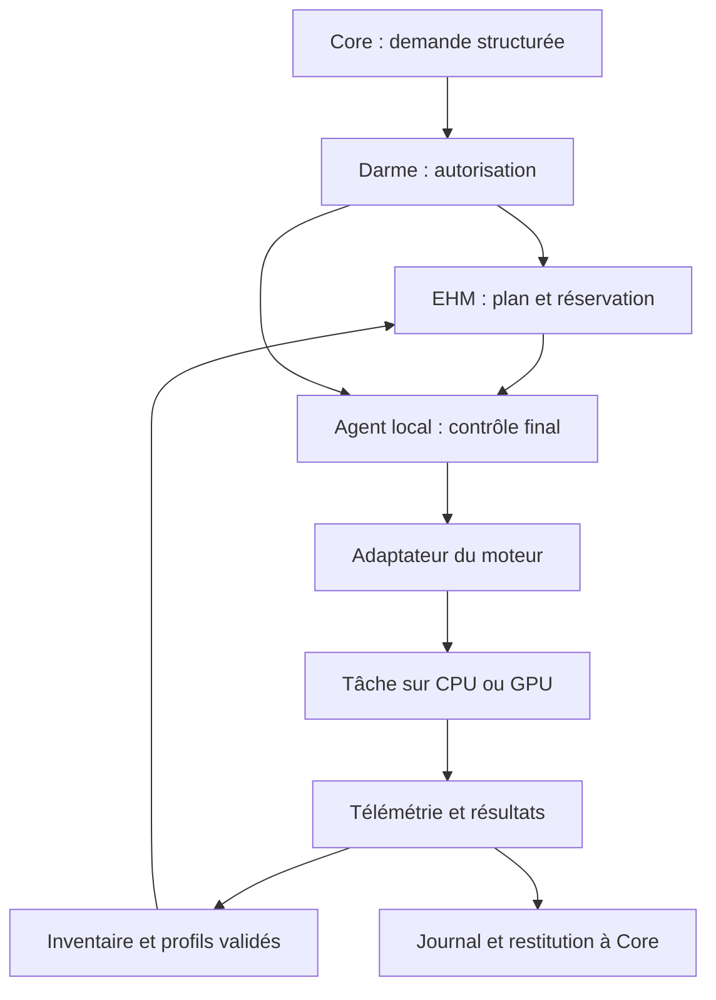
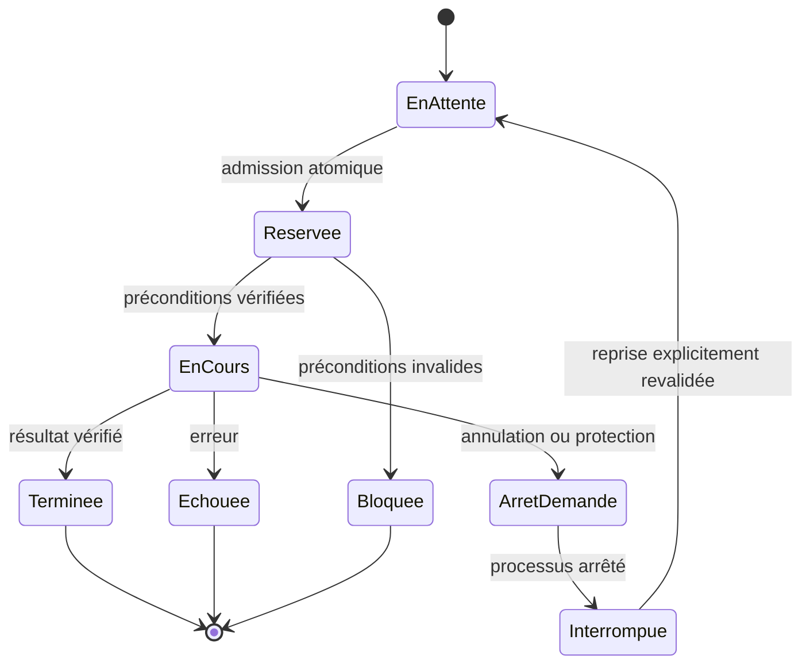

# Étude : gestion matérielle Eidolon
Date : 8 novembre 2026  
Statut : proposition de développement à qualifier, sans implémentation ni déploiement.  
Nom de travail : **Eidolon Hardware Manager** (EHM).

## 1. But et périmètre

Traduire une demande de travail en une allocation matérielle reproductible :
choisir un moteur compatible, réserver les ressources, appliquer un profil
autorisé, lancer le travail, surveiller son exécution et conserver les mesures.

EHM réutilise les pilotes et moteurs de calcul existants. Il ne remplace pas CUDA,
ne fusionne pas automatiquement les VRAM et ne rend pas un programme mono-GPU
compatible multi-GPU. La répartition du calcul reste une capacité du moteur.

Première cible : Linux, un hôte de calcul, GPU NVIDIA et un seul moteur qualifié.
Les extensions CPU, GPU hétérogènes et plusieurs hôtes viennent ensuite.
Aucun achat d'adaptateur double ou NVLink n'est requis pour le prototype.

## 2. Contexte connu et vérifications préalables

- La passerelle MCP est déjà sur le NAS ; elle donne accès au serveur Core/Memory
  et à la machine Eidolon-OS X399. Elle reste le point d'accès administratif.
- X399 / Threadripper 1950X est la plateforme visée pour les essais.
- Les V100 SXM2 sur adaptateurs PCIe motivent cette étude. La présence physique
  de plusieurs cartes ne prouve ni une liaison NVLink ni son utilisation.
- La consigne de travail récente fixe la référence V100 à **200 W par carte**
  pour les tests et exercices. C'est une limite demandée, pas une consommation
  constante ni une preuve qu'elle est actuellement appliquée.
- Avant tout essai : relever UUID GPU, hôte, emplacement PCIe, topologie, version
  du pilote, environnement logiciel, mémoire disponible, refroidissement et
  services concurrents. Vérifier quelle machine mesure chaque prise Shelly.
- Cette étude ne constitue pas un relevé en direct du matériel ou des services.
  Les détails d'intégration Core/Darme sont proposés et restent à auditer.

## 3. Architecture proposée

Le NAS transporte les demandes et les retours ; il n'héberge pas les poids ou le
calcul par défaut. L'agent sur l'hôte conserve la surveillance locale pendant
une coupure réseau. Un seul ordonnanceur possède les réservations d'un hôte.

| Composant proposé | Responsabilité |
|---|---|
| Inventaire | UUID stables, VRAM, CPU/RAM, topologie, capacités et fraîcheur des observations |
| Profils | Paramètres validés par carte, moteur, modèle et type de tâche |
| Planificateur | Admission, priorité, attente et explication du choix |
| Agent local | Réserver, contrôler les préconditions, lancer et arrêter ses propres tâches |
| Adaptateurs | Traduire une demande commune vers chaque moteur et restituer ses résultats |
| Télémétrie | Réutiliser les collecteurs existants, calculer les métriques manquantes |
| Journal | Historique des décisions, versions, erreurs, résultats et points de reprise |

Choix de départ proposé : Python, stockage SQLite local pour tâches/réservations,
profils déclaratifs versionnés, interface locale structurée. Éviter un cluster
d'orchestration ou un LLM chargé de choisir les GPU. Le dépôt de code définitif
sera choisi après audit des interfaces existantes ; ce dépôt conserve l'étude.

## 4. Contrats et cycle d'une tâche

### Données minimales

- **Demande** : identifiant idempotent, demandeur, autorisation et version de
  politique, type de tâche, moteur/modèle épinglés, priorité, durée maximale,
  contexte/batch, budget mémoire estimé et marge, ressources autorisées.
- **Profil** : UUID ou classe de matériel, provenance des mesures, versions
  pilote/runtime/bibliothèques, puissance plafonnée, seuils thermiques,
  capacités testées, date et conditions de validation.
- **Plan** : hôte, UUID réservés, mode mono-GPU/multi-GPU, budgets CPU/RAM,
  limites, justification, expiration et empreinte des profils.
- **Résultat** : état final, code de sortie, métriques, erreurs, artefacts et
  éventuel checkpoint vérifié. Un chemin de checkpoint ne prouve pas sa validité.

L'estimation mémoire inclut poids, cache de contexte, buffers et, pour
l'entraînement, activations et états d'optimisation. La VRAM libre observée
n'est pas une réservation ; revalider immédiatement avant le lancement.

Après crash, réconcilier le journal avec les processus réellement présents avant
de libérer une réservation ou de relancer une tâche. Une demande dupliquée ne
doit pas produire deux lancements. Une reprise exige des droits encore valides,
des ressources disponibles et un checkpoint compatible si nécessaire.

## 5. Autorisation, isolation et incidents

- Le LLM propose une demande structurée ; il ne fournit pas de commande shell.
  Core et Darme contrôlent les droits ; l'agent local vérifie le plan autorisé.
- Les contenus de modèles, fichiers et résultats ne peuvent pas élargir les
  permissions. L'agent n'accepte que des moteurs, chemins et paramètres prévus.
- Service non privilégié ; opérations privilégiées réduites à une interface
  dédiée et bornée, par exemple un réglage de puissance autorisé pour un UUID.
- Un GPU par tâche dans le MVP, avec visibilité restreinte et isolation de
  processus adaptée. Une variable de sélection GPU seule n'est pas une
  frontière de sécurité ; vérifier les droits sur les périphériques.
- Un GPU passé à une VM appartient à cette VM : ne pas l'allouer aussi à l'hôte.
  Les charges externes restent possibles ; les détecter et bloquer l'admission
  si l'exclusivité n'est pas assurée.
- Limite V100 200 W relue après application et après redémarrage. Échec de
  lecture/application : bloquer le lancement géré concerné et expliquer.
  La limite totale de la machine inclut CPU, cartes et périphériques.
- Seuil thermique propre à chaque profil, fixé avant essai. Télémétrie périmée :
  aucune nouvelle admission ; un watchdog local applique la politique d'arrêt
  préétablie aux tâches gérées. Ne pas confondre zéro et mesure indisponible.
- Arrêt gracieux, délai borné puis terminaison du groupe de processus concerné.
  Pas de reset GPU partagé ni d'arrêt d'autres services par défaut.
- Priorité conversationnelle : réserver des ressources ou attendre une frontière
  de tâche. Pas de préemption instantanée promise ; un checkpoint doit être
  explicitement pris en charge par le moteur d'entraînement.
- Perte du NAS/Core : continuer seulement la tâche déjà autorisée dans ses
  limites et sa durée ; pas de nouvelle tâche. Résultats conservés localement.
- Retour arrière : désactiver EHM, terminer ses tâches proprement, libérer ses
  réservations et rétablir les services précédents. Ne pas relever
  automatiquement la limite V100 au-dessus de 200 W lors du retrait.

## 6. Phases de développement et critères de passage

| Phase | Travail et livrable | Condition de passage |
|---|---|---|
| P0 — Audit | Inventaire en lecture seule, interfaces Core/Darme, propriétaire des GPU, versions et référence de charge | Capacités connues, inconnues identifiées, aucun réglage modifié |
| P1 — Observation | Collecteur réutilisant l'existant, profils et historique borné | Mesures fiables, erreurs/capteurs absents gérés, coût du service mesuré |
| P2 — Simulation | Demandes structurées, politiques, choix expliqués, réservations simulées | Aucun lancement réel ; cas d'indisponibilité, doublons et refus couverts |
| P3 — MVP mono-GPU | Un moteur d'inférence qualifié, admission atomique, lancement et arrêt, profil 200 W | Pas de double allocation ; résultat correct ; arrêt et reprise après crash vérifiés |
| P4 — Apprentissage | Adaptateur pour le moteur réellement utilisé par Eva, checkpoints et budgets | Reprise contrôlée, résultats comparables à l'exécution directe |
| P5 — Plusieurs GPU | Deux travaux indépendants puis modèle réparti si supporté ; NVLink seulement si présent | Gain mesuré à configuration égale ; aucun regroupement automatique sans qualification |
| P6 — Intégration | Core, Darme, HUD et synthèses Memory ; sélection à partir des profils mesurés | Campagne de cohabitation réussie et retrait vérifié |
| P7 — Extensions | Autres GPU, CPU/NUMA, autres hôtes, selon besoins constatés | Chaque nouveau couple matériel/moteur a sa propre recette |

Le premier incrément implémentable est P0/P1. P2/P3 précèdent l'ajout d'un second
moteur. Aucun calendrier ferme avant l'audit : la compatibilité des moteurs et
la visibilité hôte/VM constituent les principales inconnues.

## 7. Campagne de qualification

Comparer une exécution directe de référence et une exécution gérée, avec même
matériel, limite de puissance, modèle, quantification, contexte, batch, données,
versions et concurrence. Alterner les essais et réaliser au moins trois répétitions,
en séparant chargement à froid et fonctionnement à chaud.

Mesures :
- inférence : temps avant premier token, débit, latences p50/p95, qualité ;
- entraînement : durée des étapes, tokens/s utiles, validation et reprise ;
- ressources : CPU, RAM, VRAM maximale, température, throttling, erreurs ;
- énergie : Wh au secteur par tâche et puissance GPU séparément, avec périmètre
  Shelly vérifié et trous de mesure signalés ;
- cohabitation : conversation et, si actif sur le même hôte, Nomifactory-test,
  avec TPS, MSPT p50/p95/p99 et pics sur le même monde et la même charge.

Budgets de recette **proposés, non mesurés**, à figer avant la campagne :
- EHM au repos : moins de 100 MiB de RSS et moins de 1 % d'un cœur CPU en moyenne ;
- perte de débit due à la gestion : au plus 3 % si supérieure au bruit des essais ;
- dégradation de latence p95 du service prioritaire : au plus 5 % ;
- Nomi : pas de dépassement nouveau et durable du budget de 50 ms/tick pour 20 TPS,
  et pas de dégradation p95 supérieure à 5 % ; si la référence dépasse déjà ce
  budget, qualification de cohabitation bloquée jusqu'à définition d'un objectif ;
- zéro double lancement/allocation, zéro modification hors autorisation, zéro
  perte silencieuse de statut dans les scénarios d'incident testés.

Collecte proposée : toutes les 2 à 5 secondes en activité, moins fréquente au
repos, ajustée aux besoins du watchdog et au coût mesuré. Réutiliser hwmon/Darme
si leurs données conviennent. Rétention détaillée bornée (cible initiale 14 jours),
résumés conservés ; aucun contenu de conversation nécessaire dans la télémétrie.

Scénarios de panne : OOM, GPU indisponible, renumérotation après reboot, processus
externe, moteur incompatible, refus de changement de puissance, capteur absent,
disque plein, crash du gestionnaire, perte réseau, expiration d'autorisation,
annulation et checkpoint corrompu. Vérifier les effets réels, pas seulement les logs.

Pour le multi-GPU, distinguer deux tâches indépendantes et un modèle réparti.
Pour NVLink, relever topologie, liens actifs, transferts P2P et comportement du
moteur. Si possible comparer avec/sans usage du lien à paramètres identiques ;
sinon ne pas attribuer le gain à NVLink. La vidéo seule ne fournit pas cette preuve.

## 8. Compatibilité et décisions différées

Privilégier NVML pour les mesures NVIDIA prises en charge ; prévoir des valeurs
indisponibles explicites et une collecte de diagnostic bornée avec nvidia-smi.
Les capacités de gestion dépendent de la carte et du pilote : les sonder.

Pour Volta, vérifier un environnement compatible avec l'architecture V100 :
CUDA 13 retire la compilation ciblant ces GPU et leur support dans ses bibliothèques.
Épingler un ensemble réellement testé, sans supposer qu'une version CUDA suffit
à garantir la compatibilité de PyTorch, du moteur ou de tous ses kernels.

À décider après P0 : moteur d'inférence initial, environnement d'entraînement,
placement exact hôte/VM, protocole local et dépôt d'implémentation.
Différés : réglage automatique des fréquences, ventilation externe pilotée,
entraînement distribué, migration de processus GPU, ordonnancement multi-hôte.
Aucune modification matérielle, firmware ou pilote dans le périmètre de cette étude.

## 9. Livrables et décision finale

Livrables attendus : inventaire horodaté, contrats versionnés, profils validés,
prototype isolé, tests d'incident, protocole et résultats bruts, rapport de coût,
procédure d'exploitation et retour arrière.

Décision par phase : **retenir**, **simplifier**, **reporter** ou **écarter**.
Une absence de gain ou une surcharge excessive justifie de rester à un lanceur
simple avec profils fixes. La validation dépend des mesures, pas du nombre de fonctions.

## 10. Références

Consultées le 8 novembre 2026 ; revalider les versions au démarrage de P0.

- [NVML : API officielle](https://docs.nvidia.com/deploy/nvml-api/latest/index.html)
- [nvidia-smi : diagnostic et topologie](https://docs.nvidia.com/deploy/nvidia-smi/index.html)
- [Ollama : placement des modèles et multi-GPU](https://docs.ollama.com/faq)
- [NVIDIA : compatibilité des architectures et CUDA](https://developer.nvidia.com/blog/navigating-gpu-architecture-support-a-guide-for-nvidia-cuda-developers)
- [Vidéo ayant motivé la discussion](https://www.youtube.com/watch?v=8qGvoDX4lK4) :
  démonstration utilisateur, non utilisée comme preuve de performances d'Eidolon.
